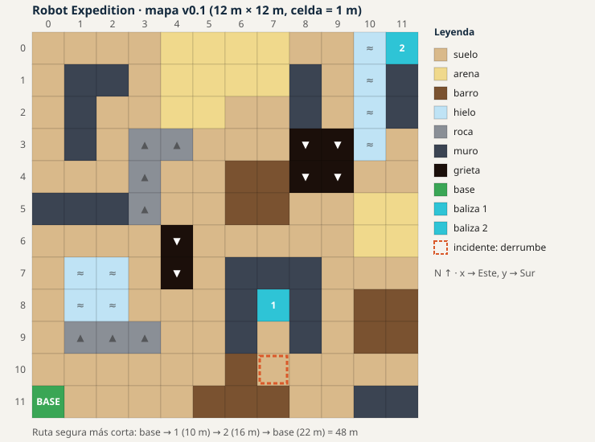

# Ambiente v0.1 — Robot Expedition

> Equipo Robot Expedition · MLOps Autonomous Lab · Experimento 01 · 28 oct 2026
> Código: `expedicion/` · Ambiente Gymnasium `RobotExpedition-v0` · Dibujo: [mapa-v0.1.svg](mapa-v0.1.svg)

## Mision y mapa

**Misión:** salir de la base, agarrar una muestra en la **baliza 1**, luego en la **baliza 2**
(en ese orden) y **volver a la base** antes de agotar la batería y antes de 200 s.

- Sala plana de **12 m × 12 m**, rejilla de celdas de **1 m**. `x` crece hacia el Este, `y` hacia el Sur.
- **Inicio y regreso:** base en (0, 11). **Baliza 1:** (7, 8), dentro de un recinto con un único acceso por el Sur. **Baliza 2:** (11, 0).
- **Límites:** el borde del mapa actúa como muro infranqueable.
- **Obstáculos y terrenos:**

| Código | Terreno | Caminar | Saltar por encima | Batería al entrar | Efecto |
|---|---|---|---|---|---|
| `.` | suelo | sí | sí | 0.6 % | — |
| `a` | arena | sí | sí | 1.2 % | gasta el doble |
| `b` | barro | sí | sí | 1.8 % | puede **atascar** (no avanza) |
| `h` | hielo | sí | sí | 0.6 % | puede **patinar** 1 celda más |
| `R` | roca baja | no (choque) | **sí** | — | obstáculo saltable |
| `#` | muro alto | no | no | — | obstáculo infranqueable |
| `G` | grieta | cae | **sí** | — | caer = **fracaso** |

- **Ruta segura más corta** (Dijkstra, caminando o saltando sin pisar grietas): base → 1 = 10 m, 1 → 2 = 16 m, 2 → base = 22 m. **Total 48 m.**
- **Dilema de diseño:** para llegar a la baliza 2 el camino corto pasa por una **columna de hielo** pegada a una **grieta**. Con tormenta y baja gravedad, patinar ahí puede ser mortal.

## Variables y unidades

Un paso de simulación (Δt) dura **1 s**.

| Variable | Significado | Unidad | Rango | ¿Visible para el agente? |
|---|---|---|---|---|
| `pos` (x, y) | posición del robot | m | 0–11 × 0–11 | **no** (solo relativa al objetivo) |
| `mapa` | terreno de cada celda | — | 10 códigos | **no** (solo rayos y terreno bajo las ruedas) |
| `bateria` | energía restante | % | 0–100 | sí |
| `etapa` | objetivo actual | — | 0 = baliza 1, 1 = baliza 2, 2 = base | sí |
| `velocidad` | metros recorridos en el último paso | m/s | 0–3 | sí |
| `clima` | despejado / lluvia / tormenta | — | 3 valores | sí (sensor meteorológico) |
| `gravedad` | luna / marte / tierra | m/s² | 1.62 · 3.71 · 9.81 | sí (parámetro de misión) |
| `pasos` | tiempo transcurrido | s | 0–200 | no |
| `incidente` | perturbación activa | — | ninguno / corredor bloqueado | no |

**Parametría** (en `params.yaml`; propuestas por calibrar):

| Parámetro | Valor v0.1 | Unidad | Qué cambia |
|---|---|---|---|
| Tamaño del mapa | 12 × 12 | m × m | escala del recorrido |
| Ancho de pasillos | 1 (mínimo) | m | dificultad de navegación |
| Velocidad máxima | 1 caminando, 2 saltando | m/s | capacidad de avance |
| Ruido de distancia | 0.1 × (1 · 1.5 · 2.5 según clima) | m (desv. estándar) | calidad de sensores |
| Alcance de sensores | 5 | m | anticipación de obstáculos |
| Batería inicial | 100 | % | autonomía |
| Límite de tiempo | 200 | s | duración máxima del episodio |

**Efectos del clima:**

| Clima | P(patinar en hielo) | P(atasco en barro) | Consumo | Ruido de sensores |
|---|---|---|---|---|
| despejado | 0.20 | 0.25 | × 1.00 | × 1.0 |
| lluvia | 0.35 | 0.40 | × 1.15 | × 1.5 |
| tormenta | 0.50 | 0.50 | × 1.35 | × 2.5 |

**Efectos de la gravedad g:**
- costo de salto = 1 + 2·g/9.81 % (Luna 1.33 %, Marte 1.76 %, Tierra 3.0 %).
- P(pasarse 1 m de largo al saltar) = 0.3·(1 − g/9.81) (Luna 25 %, Marte 19 %, Tierra 0 %).
- menos tracción: P(patinar) × [1 + 0.5·(9.81 − g)/9.81] (Luna × 1.42).

## Observaciones y acciones

**Estado del mundo** (lo conoce el simulador): posición absoluta, mapa completo con incidente, batería, etapa, clima, gravedad, pasos y el generador aleatorio.

**Observación** (`spaces.Dict`, lo que recibe el agente):

| Clave | Espacio | Descripción |
|---|---|---|
| `rayos` | Box(0, 5, (8,)) | distancia en m al primer muro/roca/grieta en N, NE, E, SE, S, SO, O, NO, con ruido gaussiano |
| `objetivo` | Box(−11, 11, (2,), int) | vector (dx, dy) al objetivo actual |
| `distancia_objetivo` | Box(0, 22, (1,)) | norma euclidiana del vector anterior, en m |
| `velocidad` | Box(0, 3, (1,)) | m/s del último paso |
| `bateria` | Box(0, 100, (1,)) | % |
| `etapa` | Discrete(3) | 0 baliza 1 · 1 baliza 2 · 2 base |
| `terreno` | Discrete(10) | terreno bajo las ruedas |
| `clima` | Discrete(3) | despejado · lluvia · tormenta |
| `gravedad` | Box(0, 15, (1,)) | m/s² |

**Acciones** (`Discrete(9)`), con un solo actuador por paso:

| # | Acción | Efecto |
|---|---|---|
| 0–3 | mover N / S / E / O | avanza 1 m si la celda es pisable; si no, **choque** |
| 4–7 | saltar N / S / E / O | avanza 2 m **por encima** de roca o grieta; no cruza muros |
| 8 | agarrar | toma la muestra si está sobre la baliza que toca |

## Dinamica

Observación → acción → física → recompensa → nueva observación. En cada `step(a)`:

1. **Barro:** si el robot está en barro y se mueve o salta, con P(atasco) **no avanza** pero gasta 1.8 % de batería.
2. **Mover:** si la celda destino es pisable, el robot entra y gasta el costo de ese terreno. Si es un muro, una roca o el límite del mapa, choca: no se mueve y gasta 0.5 % extra.
3. **Saltar:** gasta `costo_salto(g)`. La celda intermedia debe ser saltable (no muro) y la de aterrizaje pisable; si no, el salto queda **bloqueado** (choque). Con baja gravedad puede **pasarse 1 m de largo**.
4. **Hielo:** al terminar sobre hielo después de moverse, con P(patinar) se desliza 1 celda más, recto o hacia un costado. Si esa celda es una grieta, el robot cae.
5. **Agarrar:** cuesta 0.3 %. Solo es válido sobre la baliza de la etapa actual y avanza la etapa.
6. **Batería:** se multiplica el gasto por el factor de consumo del clima y se resta.
7. **Fin:** se revisa en este orden: caída en grieta, misión completa, batería en 0 y límite de tiempo.

## Recompensa

| Componente | Valor | Justificación |
|---|---|---|
| paso | −0.05 por paso | el tiempo cuesta |
| consumo | −0.02 por cada % de batería gastado | maniobras caras se pagan |
| progreso | +0.5 × (ruta_restante_antes − ruta_restante_después) | moldeado por **potencial** Φ = −0.5·ruta restante (Dijkstra). Un ciclo cerrado suma 0 |
| baliza correcta | +10 (una vez, en orden) | hito de la misión |
| agarre inválido | −1 | evita spam de "agarrar" |
| choque | −1 | colisiones |
| caída en grieta | −25 y termina | fracaso grave |
| batería agotada | −15 y termina | fracaso |
| misión completa | +30 + 0.1 × batería restante | éxito; premia ahorrar energía |

## Exito, fracaso y limite de tiempo

- **Éxito** (`terminated=True`): volver a la base después de agarrar ambas balizas en orden.
- **Fracaso** (`terminated=True`): caer en una grieta o agotar la batería.
- **Límite de tiempo** (`truncated=True`): 200 pasos (200 s) sin terminar. Es truncamiento, no fracaso: el agente sí suma el valor futuro en Q-learning.

## Metricas e incidente

**Métricas elegidas:**
1. **Tasa de misión completa** (% de episodios con éxito).
2. **Batería final en éxitos** (% restante → eficiencia energética).
3. **Choques por episodio** (seguridad), además de la tasa de caída en grietas.

**Perturbación:** `corredor_bloqueado`. Un derrumbe pone una roca en (7, 10), el único corredor hacia la baliza 1. Sigue siendo resoluble si el robot salta por encima de la roca.

**Resultados del experimento 01** (180 escenarios fijos por agente: 3 climas × 3 gravedades × 2 incidentes × 10 semillas; `metrics/evaluacion.json`):

| Agente | Misión (sin incidente) | Misión (corredor bloqueado) | Batería final en éxito | Choques/episodio (sin incidente) | Caídas |
|---|---|---|---|---|---|
| **experto** (Q-learning, 30 000 episodios) | **98.9 %** | 0 % | 46.5 % | 0.0 | 0 % |
| aprendiz (Q-learning, 2 400 episodios) | 0 % | 0 % | — | 80.2 | 8 % |
| codicioso (heurística) | 0 % | 0 % | — | 47.5 | 0 % |
| aleatorio | 0 % | 0 % | — | 13.3 | 63 % |

**Lectura:** el experto domina el mapa con cualquier clima y gravedad. Ante el derrumbe falla siempre: repite un salto bloqueado contra la roca (52 choques por episodio en promedio). La política tabular memorizó *celdas*, no aprendió a *reaccionar a los rayos*. Esto define el objetivo del experimento 02.

## Cinco transiciones

Simuladas con el ambiente real: `expedicion transiciones --clima lluvia --gravedad marte --semilla 3 -n 9`, agente experto, pasos t = 3 a 7.
La observación de cada fila es la *nueva observación* de la fila anterior. Rayos en orden N/E/S/O, en m.

| t | Observación (dx,dy · batería · terreno · rayos N/E/S/O) | Acción | Nuevo estado (x,y · batería) | Recompensa | Fin |
|---|---|---|---|---|---|
| 3 | (1,−3) · 93.9 % · barro · 1.5/3.7/0.5/5.0 | mover E | (6,11) · 91.9 % — **atascado en barro** | −0.05 − 0.02·2.07 = **−0.09** | no |
| 4 | (1,−3) · 91.9 % · barro · 1.1/3.4/0.5/4.9 | mover E | (7,11) · 89.8 % | −0.05 − 0.04 + 0.5·1 = **+0.41** | no |
| 5 | (0,−3) · 89.8 % · barro · 3.5/2.6/0.7/4.9 | saltar N | (7,9) · 87.8 % — salto de 2 m | −0.05 − 0.04 + 0.5·2 = **+0.91** | no |
| 6 | (0,−1) · 87.8 % · suelo · 1.4/0.1/2.6/0.5 | mover N | (7,8) · 87.1 % — sobre la baliza 1 | **+0.44** | no |
| 7 | (0,0) · 87.1 % · baliza 1 · 0.6/0.4/3.7/0.4 | agarrar | (7,8) · 86.7 % — etapa → baliza 2 | −0.05 − 0.007 + 10 = **+9.94** | no |

En t = 3 el consumo de 2.07 % es 1.8 % del barro × 1.15 por la lluvia. En t = 6 los rayos E y O miden 0.1 y 0.5 m: son los muros del recinto de la baliza 1.

## Posibles trampas y decisiones pendientes

**Reto del equipo: ¿puede ganar visitando la misma baliza repetidamente?** No:
- El bono de baliza se paga **una sola vez** y **solo en orden**: agarrar la baliza 2 antes que la 1 no avanza la etapa, y repetir un agarre cuesta −1. Lo verifica `tests/test_ambiente.py::test_baliza_solo_paga_una_vez_y_en_orden`.
- Al cambiar de etapa el objetivo cambia, así que quedarse junto a una baliza no da progreso.

**Otras trampas encontradas:**
1. **Dar vueltas para cobrar "progreso"** (*encontrada y corregida*). Con moldeado γ·Φ(s′) − Φ(s) y γ = 0.99, ir y volver entre dos celdas pagaba **+0.35 por vuelta**. Ahora se usa γ = 1 en el moldeado: un ciclo cerrado suma exactamente 0 y la penalización por paso lo vuelve negativo. Lo verifica `test_dar_vueltas_no_genera_recompensa`.
2. **Morir lejos de la meta para "cobrar" el potencial.** Con la convención Φ(terminal) = 0, caer en una grieta lejos de la base daría +0.5 × ruta restante (hasta +24, casi igual a la penalización de −25). En los pasos de fracaso no se aplica moldeado.
3. **Saltar todo el tiempo** (*observada, pendiente*). El experto salta en casi todos los tramos de suelo. Un salto avanza 2 m por 2 % de batería, mientras que caminar 2 m cuesta 1.2 % pero tarda 2 pasos. Con la recompensa actual saltar paga un poco más (+0.91 frente a +0.87). ¿Queremos ese comportamiento? Opciones: subir el costo del salto, añadir un enfriamiento entre saltos o un riesgo de daño al aterrizar.

**Decisiones pendientes:**
- **Orientación y giro.** La ficha pide "avance y giro"; v0.1 usa 4 direcciones absolutas en una rejilla. En v0.2 se pasará a orientación + avanzar/girar, y luego a espacio continuo.
- **9 rayos.** La ficha pide 9; v0.1 usa 8 (rosa de los vientos). Falta decidir si el noveno apunta al suelo (detector de grieta) o si se usa un abanico frontal.
- **Generalización.** La tabla Q ignora los rayos, por eso falla con el incidente. Siguiente experimento: un agente con observación local (DQN/PPO) y entrenamiento con incidentes y mapas aleatorios.
- **Unidades de batería.** Ahora es un % relativo; falta pasarlo a Wh con un modelo de motor.
- **Calibrar coeficientes.** Probabilidades de patinar y atascarse, costos por terreno y efectos de la gravedad son propuestas, no medidas.
- **Clima según el planeta.** El visor muestra cada gravedad como un planeta: polvo y tormenta de polvo en Marte, micrometeoritos y tormenta solar en la Luna, lluvia en la Tierra. Hoy es solo visual: los coeficientes de clima son los mismos en los tres. Falta decidir si cada planeta tendrá su propio modelo de clima (por ejemplo, sin barro ni lluvia en la Luna).
- **Clima dinámico.** Hoy el clima es fijo en todo el episodio; podría cambiar a mitad de la misión.
- **Mapas como dataset.** Generar mapas procedimentales versionados con DVC en vez del único mapa fijo.
